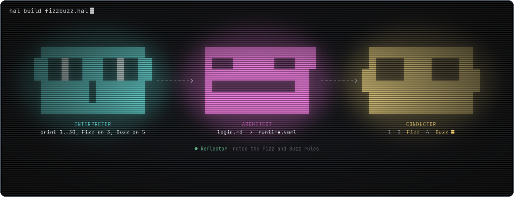
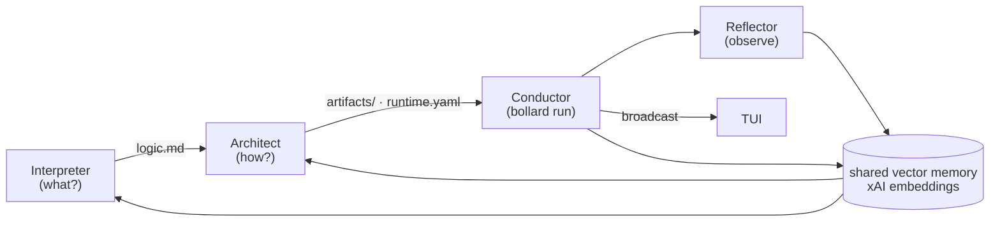

<div align="center">
  
</div>

**HAL** :: *Higher-order Agentic Loop — a natural-language pseudo-code interpreter*

<div align="center">

[](Cargo.toml)
[](https://www.rust-lang.org)
[](https://github.com/0xPlaygrounds/rig)
[](Cargo.toml)

</div>

> [!NOTE]
> HAL is a research project, provided as is. Development is slow, so expect
> rough edges and don't count on a quick turnaround.

<br>

`hal` takes a plain-English `.hal` file, runs it through a three-agent
pipeline (Interpreter → Architect → Conductor), and executes
the resulting program inside a Docker container.



## Install

`hal` is a single Rust binary. `./install.sh` builds a release binary in this
repo's `target/` and copies it onto your `PATH`, so a later install reuses
the incremental cache. `just install` is that same script.

```sh
# User install → ~/.cargo/bin
./install.sh
# or: just install

# System install → /usr/local/bin (needs sudo)
./install.sh --system
# or: just install-system
```

Build through `./install.sh`. `cargo install --path .` compiles in a
throwaway target directory and rebuilds the native dependencies (bundled
sqlite, blake3, OpenSSL) on every run.

Requirements:

- Rust 1.75+ stable (`curl https://sh.rustup.rs -sSf | sh`)
- A C toolchain, `pkg-config`, and OpenSSL headers (`libssl-dev`). The crate links OpenSSL through `native-tls`.
- Docker daemon running on the host (only needed for `hal run`, not for `hal build`)
- `MAPERTUI_XAI_TOKEN` in the environment, or in `.env` at the repo root, or in `HAL/.env`. An already-exported variable wins, then `.env`, then `HAL/.env`.

Verify:

```sh
hal --version
hal examples/fizzbuzz.hal         # TUI
hal examples/fizzbuzz.hal -d      # detached, pipes the container output straight to your terminal
```

## Quick start

```sh
export MAPERTUI_XAI_TOKEN=xai-...
hal examples/fizzbuzz.hal -d
```

`-d` (detached) behaves like running the script directly — only the
container's stdout/stderr reach your terminal. Drop the flag to get the
tabbed ratatui dashboard (**Compiler** tab = full agentic flow,
**[Conductor] Output** tab = live container log).

## Commands

| invocation                          | does                                                                     |
|-------------------------------------|--------------------------------------------------------------------------|
| `hal build <file.hal>`              | Interpreter + Architect only. Needs `MAPERTUI_XAI_TOKEN`.               |
| `hal run <file.hal> [args...]`      | build if the source hash changed, then Conductor + Reflector. Needs Docker. |
| `hal <file.hal> [args...]`          | shorthand for `hal run`. Tokens after the file are the script's own arguments. |
| `-d` / `--direct`                   | detached: container stdout/stderr only, no TUI and no pipeline chatter  |
| `-f` / `--force`                    | rebuild even when `build.lock` matches the source                       |
| `-v` / `--verbose`                  | also log to stderr. `~/.hal/logs/hal.log` is always written.            |

A run whose source hash matches `build.lock`, and whose `logic.md` and
`runtime.yaml` are still on disk, skips Interpreter and Architect.

## Project layout

Building `foo.hal` produces a sibling `.hal/<project-id>/` directory:

```
foo.hal
.hal/
  config.toml           # optional; applies to every source in this directory
  5ab082921eb75950/
    logic.md            # Interpreter output
    artifacts/          # Architect output (mounted read-only at /work)
    runtime.yaml        # Architect output — image + entrypoint
    build.lock          # source hash, image, entrypoint, timestamp
    memory/hal.sqlite   # vector-embedded per-agent notes (Conductor namespace also receives Reflector observations)
    runs/<ts>/          # stdout.log, stderr.log, meta.json
    logs/               # per-project event log
```

`project-id` is `blake3(canonicalize(source_path))[..16]`, so the same
`.hal` file always resolves to the same project even across `cd`s.

## Agents

| agent       | role                | tools                                                          |
|-------------|---------------------|----------------------------------------------------------------|
| Interpreter | source → `logic.md` | `files_read` (source only), `files_write`, `memory_*`, `web_search` |
| Architect   | logic → artifacts   | all of the above + `spawn_agent` (cap 4)                       |
| Conductor   | artifacts → running | **deterministic** Rust (bollard) — runs the container          |
| Reflector   | run → memory notes  | LLM turn after the container exits: `files_read`, `memory_*`, `web_search` |

The Conductor stays deterministic on purpose — Docker orchestration is
not something we want an LLM to improvise. The **Reflector** is a
separate LLM turn that runs *after* the container exits: it reads the
run's stdout/stderr tails and `meta.json`, then writes durable
observations into the Conductor memory namespace so the next
Interpreter/Architect/Conductor cycle can learn from what actually
happened at runtime. This is what closes the memory loop.

The Interpreter identity, Architect identity, Conductor identity, tool
reference, and flow diagram all live in [`HAL/`](./HAL/) and are
baked into the binary via `include_str!`.

## Memory

Per-project SQLite file. Each note is embedded against xAI's
`embedding-beta-3-large` model (4096-dim) on write; `memory_search`
embeds the query and ranks notes by cosine similarity inside the
calling agent's namespace. When no `MAPERTUI_XAI_TOKEN` is configured the
store falls back to recency + substring lookup so offline tests still
work.

The Conductor namespace is written to by two parties: the deterministic
runner (bare facts — image, command, exit code, log tails) and the
Reflector (LLM-generated observations and concrete fixes).

## Configuration

Everything model-facing can be set via `<source_parent>/.hal/config.toml`:

```toml
model = "grok-4.20-0309-reasoning"
embedding_model = "embedding-beta-3-large"
embedding_dims = 4096
default_image = "debian:stable"
base_url = "https://api.x.ai/v1"
conductor_reflect = true
conductor_reflect_max_turns = 6
memory_search_k = 5
```

The values above are the built-in defaults, so a missing file behaves the
same way. `debian:stable` (not the slim variant) is the default image so
the container has bash, apt, coreutils, and curl. Unknown keys are
rejected.

Environment variables override the TOML: `GROK_MODEL`,
`HAL_EMBEDDING_MODEL`, `HAL_EMBEDDING_DIMS`, `HAL_DEFAULT_IMAGE`,
`HAL_CONDUCTOR_REFLECT`, `HAL_CONDUCTOR_REFLECT_MAX_TURNS`,
`HAL_MEMORY_SEARCH_K`, `XAI_BASE_URL`, and `MAPERTUI_XAI_TOKEN`.

## Development

Install [`just`](https://just.systems) and run `just` to list recipes.
Every recipe shares this repo's `target/` directory. Day-to-day recipes
compile the debug binary, which is enough to execute `.hal` files. Use
the release recipes when you want the optimized binary that `just install`
ships.

```sh
just build                 # cargo build --bin hal
just release               # cargo build --release --locked --bin hal
just install               # ./install.sh → ~/.cargo/bin
just install-system        # ./install.sh --system

just run examples/fizzbuzz.hal            # debug, TUI
just run-direct examples/fizzbuzz.hal     # debug, detached (-d)
just build-hal examples/fizzbuzz.hal      # debug `hal build`, no container
just run-release FILE                     # release, TUI
just run-direct-release FILE              # release, detached

just fmt                   # cargo fmt
just lint                  # rustfmt --check + clippy -D warnings
just clean                 # cargo clean
just clean-projects        # wipe examples/.hal
just show-config FILE      # resolved config for a source file
```

`just show-config` tries a `show_config` example that is not in the tree
yet, then prints a hint to inspect `<dir>/.hal/config.toml` and the
environment.

A checkout needs Rust, a C toolchain, OpenSSL headers, and `just`. Docker
is required to run a `.hal` file. This repo does not ship a
`.devcontainer/`. Put `MAPERTUI_XAI_TOKEN` in the environment or in `.env`
/ `HAL/.env` before `just build-hal`, `just run`, or the live tests.

Logs for every invocation append to `~/.hal/logs/hal.log`, or to
`$XDG_STATE_HOME/hal/logs` when that variable is set. `HAL_LOG_DIR`
overrides both. `-v` also prints them on stderr. `RUST_LOG` and `HAL_LOG`
use `tracing` `EnvFilter` syntax. The default filter is
`hal=debug,bollard=info,rig=info`.

The release profile in `Cargo.toml` is tuned for install speed (`lto` off,
`codegen-units = 16`, symbols stripped). Identity docs in [`HAL/`](./HAL/)
are compiled in with `include_str!`, so a prompt or logo edit shows up
only after a rebuild.

## Testing

```sh
just test               # offline suite: cargo test --lib --bins --tests
just test-embeddings    # live embeddings + vector memory (needs the token)
just test-live          # tests/live_xai.rs, ignored tests (token + Docker)
```

`just test` skips `#[ignore]` tests and needs neither a token nor Docker.
`just test-live` runs the live xAI suite, including a container run.

The ignored Docker tests in `src/container.rs` are separate from
`just test-live`:

```sh
cargo test --lib container:: -- --ignored --nocapture
```
